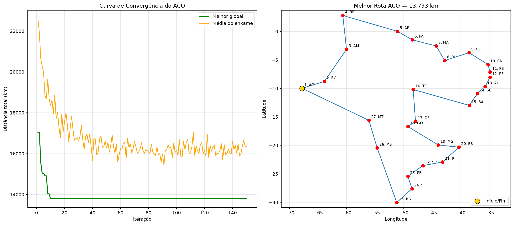

# ACO - TSP das 27 Capitais Brasileiras

Implementação de Otimização por Colônia de Formigas para encontrar um circuito turístico pelas 26 capitais estaduais e pelo Distrito Federal.



## Resultado

A execução reproduzível encontrou uma melhor distância de **13.792,78 km**.

A melhor solução foi encontrada na iteração 25 e permaneceu estável nas iterações seguintes.

**Rota encontrada:**

Rio Branco -> Porto Velho -> Manaus -> Boa Vista -> Macapá -> Belém -> São Luís -> Teresina -> Fortaleza -> Natal -> João Pessoa -> Recife -> Maceió -> Aracaju -> Salvador -> Palmas -> Brasília -> Goiânia -> Belo Horizonte -> Vitória -> Rio de Janeiro -> São Paulo -> Curitiba -> Florianópolis -> Porto Alegre -> Campo Grande -> Cuiabá -> Rio Branco

## Implementação do algoritmo

O projeto usa a variante Ant System:

1. Constrói uma matriz de distância com a fórmula de Haversine.
2. Calcula a visibilidade heurística \(η_{ij} = 1/d_{ij}\).
3. Cada formiga inicia em uma cidade aleatória e constrói uma rota sem repetições.
4. A próxima cidade é escolhida pela probabilidade:

   \(p_{ij} = τ_{ij}^{α}η_{ij}^{β} / Σ_{k∈não\ visitadas}(τ_{ik}^{α}η_{ik}^{β})\)

5. Todos os feromônios sofrem evaporação:

   \(τ_{ij} = (1-ρ)τ_{ij}\)

6. Cada formiga deposita \(Q/d_k\) feromônio nas arestas da sua rota.
7. O circuito é fechado somando a distância da última cidade até a cidade inicial.

## Parâmetros

| Parâmetro | Valor |
|---|---:|
| Alpha (α) | 1,0 |
| Beta (β) | 3,0 |
| Evaporação (ρ) | 0,1 |
| Constante de depósito (Q) | 100,0 |
| Formigas | 30 |
| Iterações | 150 |
| Inicialização dos feromônios | 0,1 |
| Semente aleatória | 42 |

## Dependências

- Python 3
- NumPy
- Matplotlib

Instalação das bibliotecas:

```powershell
python -m pip install numpy matplotlib
```

## Executando

No diretório do projeto:

```powershell
python esquetelo_tsp_27capitais_aco_ILARD_EDERSON_JOAO.py
```

O programa mostra a evolução da melhor distância no terminal e gera `resultado_aco_27_capitais.png`.

## Sobre a avaliação

A execução foi validada para confirmar que:

- cada uma das 27 cidades aparece uma única vez na rota;
- o circuito inclui o retorno à cidade inicial;
- a matriz de distância é simétrica;
- a diagonal da matriz contém distância zero;
- a melhor distância global é atualizada monotonicamente.

O cálculo usa distâncias geodésicas sobre uma esfera aproximada da Terra. Portanto, os quilômetros obtidos não representam necessariamente distâncias reais por estradas ou trajetos aéreos comerciais.
